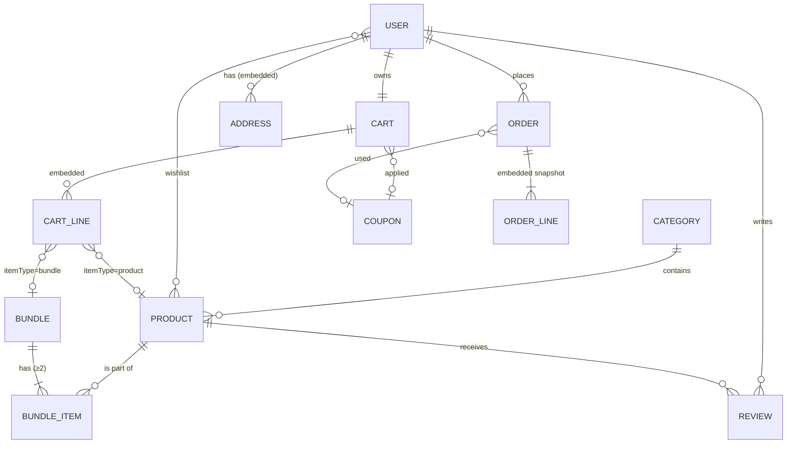

# Pharmaa × gravuta-backend — Data Schema & Implementation Plan

Scope: everything the `pharmaa` storefront (Next.js) needs from `gravuta-backend` (Express + Mongoose) to stop using mock data — catalog, bundles, users, cart, coupons, orders, reviews — and how to wire every page to it.

Status of today's code:
- **Frontend** runs entirely on mock data (`src/constants/data.ts`) and a Zustand store (`src/store/useAppStore.ts`). No HTTP calls exist.
- **Backend** already has auth, products, categories, bundles, cart (products + bundles), orders (with bundle snapshot) and admin routes. The models are thinner than what the frontend renders, and a few behaviours are wrong (listed in §3).

---

## 1. How bundles relate to products

A **Bundle** is a separately sellable entity made of **2+ existing Products**, sold at a discount, with routine metadata per product ("Step 1: Cleanse"). It is a **many-to-many** relationship:

```
Bundle 1 ──< BundleItem >── 1 Product
             (pivot: step, benefit, quantity, order)
```

| Direction | How it is stored / queried |
|---|---|
| Bundle → Products | `Bundle.items[]` embedded pivot, each with `product: ObjectId<Product>` — populated on read |
| Product → Bundles | Reverse query `Bundle.find({ 'items.product': id })`, backed by index `{ 'items.product': 1 }` — exposed as `GET /api/bundles/by-product/:productId` (the "complete the routine" upsell on the product page) |
| Price | `originalPrice = Σ product.price × item.quantity` (list price, not sale price — matches the mock data: Duo = 320 + 380 = 700). `bundlePrice = round(originalPrice × (1 − discount%))`, or admin-set and the % back-computed. `savings` is a virtual. |
| Stock | A bundle has **no stock of its own**. It is available only if every component product has `stock ≥ item.quantity × requested qty`. Ordering a bundle decrements each component. |
| Cart / Order | A line is either `itemType: 'product'` or `itemType: 'bundle'`. Orders store a **snapshot** of the bundle (names, components, prices) so history survives later edits/deletes. |

How the frontend fakes it today: `convertBundleToProduct()` turns a bundle into a pseudo-`Product` (`categorySlug: 'bundles'`, size `"Complete Set"`) so the cart can hold it. With the backend this becomes a real discriminated union (`CartLine = ProductLine | BundleLine`), and `convertBundleToProduct` is deleted.

---

## 2. Target schema



Conventions: all user-facing text is bilingual (`…En` / `…Ar`); every collection has `timestamps: true`; money is stored as a `Number` in whole SAR (switch to halalas/integers if fractional prices appear); public lookups accept **id or slug**.

### 2.1 Category (extend)

| Field | Type | Notes |
|---|---|---|
| `slug` | String, unique, lowercase | **new** — the shop filters by slug (`cleansers`, `serums`, …) |
| `nameEn`, `nameAr` | String, required | **replaces** `name` (migrate `name → nameEn`) |
| `descriptionEn`, `descriptionAr` | String | **replaces** `description` |
| `image` | String | existing |
| `sortOrder` | Number, default 0 | menu order in Header / ShopByCategory |
| `isActive` | Boolean, default true | |

### 2.2 Product (extend — biggest change)

| Field | Type | Notes |
|---|---|---|
| `slug` | String, unique | URL key (replaces mock ids like `prod_ocean_glow`) |
| `nameEn/Ar`, `subtitleEn/Ar`, `descriptionEn/Ar` | String | replaces `name`, `description` |
| `ingredientsEn/Ar`, `howToUseEn/Ar` | String | product-details tabs |
| `skinTypes` | [enum `dry\|oily\|sensitive\|combination\|normal\|mature\|all`] | **filterable**; plus `skinTypeEn/Ar` display strings |
| `benefitsEn/Ar` | [String] | |
| `price` | Number ≥ 0, required | list price |
| `discountPrice` | Number, optional, `< price` | sale price; **effective price = discountPrice ?? price** |
| `size` | String | `"50ml"` (single size today; see §6 for variants) |
| `image`, `galleryImages` | String, [String] | |
| `category` | ObjectId → Category | existing |
| `stock` | Number ≥ 0, default 0 | **new** — source of truth |
| `lowStockThreshold` | Number, default 5 | |
| `stockStatus` | virtual | `0 → out_of_stock`, `≤ threshold → low_stock`, else `in_stock` (frontend field stays the same) |
| `isBestSeller`, `isNew` | Boolean | home sections |
| `soldCount` | Number, default 0 | incremented on order → "best-selling" sort |
| `ratingAvg`, `ratingCount` | Number | maintained by Review hooks → frontend `rating`, `reviewCount` |
| `isActive` | Boolean, default true | **soft delete** (see §3 #4) |

Indexes: `{ slug: 1 }` unique, `{ category: 1, isActive: 1 }`, `{ price: 1 }`, `{ soldCount: -1 }`, text index on `nameEn, nameAr, subtitleEn` for search.

### 2.3 Bundle (keep, small additions)

Existing model is correct. Add:
- `isActive` already exists — also hide a bundle automatically when any component is inactive.
- `sortOrder: Number`.
- Virtual / computed on read: `available: boolean` (all components in stock), `effectiveOriginalPrice` (Σ component *effective* prices — used to make sure the bundle is still a deal when a component goes on sale).

`items[]` (pivot) unchanged: `product, stepEn, stepAr, benefitEn, benefitAr, quantity, order`.

### 2.4 User (extend)

| Field | Type | Notes |
|---|---|---|
| `name`, `email`, `password`, `role`, `isActive` | existing | `password` → `select: false` |
| `phone` | String | register + profile "info" tab |
| `addresses` | [AddressSchema] embedded | profile "addresses" tab + checkout step 2 |
| `wishlist` | [ObjectId → Product] | profile "wishlist" tab, heart icon |
| `passwordChangedAt` | Date | invalidate old JWTs after a password change |

`AddressSchema` (with `_id`): `fullName, phone, addressLine1, addressLine2?, city, state, postalCode, country (default "Saudi Arabia"), isDefault`. Exactly one default enforced in the route.

### 2.5 Cart (extend)

```js
cartLine = {
  itemType: 'product' | 'bundle',
  product?: ObjectId<Product>,   // when itemType = product
  bundle?:  ObjectId<Bundle>,    // when itemType = bundle
  quantity: Number ≥ 1
}
cart = { user (unique), items: [cartLine], coupon?: ObjectId<Coupon> }
```

Not stored, but **computed on every cart response** by one shared function `utils/pricing.js → priceCart(cart, { paymentMethod })`:

```json
{
  "items": [{ "itemType": "bundle", "bundle": {…}, "quantity": 1, "unitPrice": 595, "lineTotal": 595, "available": true }],
  "subtotal": 595, "discount": 119, "shippingFee": 0, "codFee": 0, "total": 476,
  "coupon": { "code": "AURA20", "valid": true }
}
```

Rules (taken from the current frontend so nothing changes visually): shipping `0` if `subtotal − discount > 200`, else `25`; COD surcharge `15`.

### 2.6 Coupon (new)

| Field | Type |
|---|---|
| `code` | String, unique, uppercase |
| `discountType` | `percentage \| fixed` |
| `value` | Number |
| `minOrderAmount` | Number, default 0 |
| `maxDiscount` | Number, optional (cap for %) |
| `expiresAt` | Date |
| `usageLimit`, `usedCount` | Number |
| `perUserLimit` | Number, default 1 |
| `descriptionEn/Ar` | String |
| `isActive` | Boolean |

Seed with `AURA20`, `SAVE50`, `GLOWGLOW` from `data.ts`.

### 2.7 Order (rework)

| Field | Type | Notes |
|---|---|---|
| `orderNumber` | String, unique | `AURA-######` (frontend shows it) |
| `user` | ObjectId → User | |
| `items` | [OrderLine] | snapshot, see below |
| `shippingAddress` | AddressSchema (copy, not ref) | **replaces** the free-text string + `phone` |
| `contact` | `{ name, email, phone }` | checkout step 1 |
| `paymentMethod` | `cod \| credit_card \| apple_pay \| google_pay` | **align with frontend** (today: `COD \| Card`) |
| `paymentStatus` | `pending \| paid \| failed \| refunded` | |
| `paymentRef` | String | gateway transaction id — **never** card data |
| `coupon` | `{ code, discountType, value }` snapshot | |
| `subtotal`, `discount`, `shippingFee`, `codFee`, `total` | Number | **replaces** `totalPrice` |
| `status` | `pending → confirmed → processing → shipped → delivered`, plus `cancelled`, `return_requested`, `returned` | frontend `in-transit` = `shipped` |
| `statusHistory` | [{ status, at, note, by }] | drives the tracking timeline on the profile page |
| `trackingNumber`, `estimatedDelivery` | String, Date | |
| `cancelReason`, `returnReason` | String | |

`OrderLine` (snapshot so history is immutable):

```js
{
  itemType: 'product' | 'bundle',
  product?, bundle?,                 // refs (may later be null)
  nameEn, nameAr, image, size,       // snapshot for display
  unitPrice, quantity, lineTotal,
  bundleSnapshot?: {                 // only for bundles (already exists)
    originalPrice, discountPercentage,
    items: [{ product, nameEn, nameAr, quantity, stepEn, stepAr }]
  }
}
```

### 2.8 Review (new)

`product → Product, user → User, rating 1–5, comment, lang ('en'|'ar'), photo?, verified (user bought the product — set server-side), helpfulCount, isApproved`. Unique index `{ product, user }`. `post('save')`/`post('deleteOne')` hooks recompute `Product.ratingAvg/ratingCount`.

### 2.9 NewsletterSubscriber (new, small)

`email (unique), lang, createdAt` — for the Footer / NewsletterRedirection forms.

---

## 3. Problems in the current backend (fix while extending)

| # | Problem | Fix |
|---|---|---|
| 1 | **`gravuta-backend/.env` is committed** and contains the live MongoDB URI/JWT secret (plus the Atlas password in a comment). | Rotate the Atlas password and `JWT_SECRET`, `git rm --cached .env`, add to `.gitignore`, commit a `.env.example`. |
| 2 | Backend `PORT=3000` collides with `next dev -p 3000`. | Backend → `5000` (or Next → 3001); add `NEXT_PUBLIC_API_URL`. |
| 3 | Bundle prices go stale when a product price changes (only a manual `/recalculate`). | In admin product `PUT`, if `price` changed, recalc every bundle containing it (`Bundle.find({'items.product': id})` → `buildBundlePricing`). |
| 4 | Deleting a product leaves bundles pointing at `null` → those bundles fail at checkout. | Soft-delete products (`isActive=false`); refuse hard delete with `409` while it's in an active bundle; auto-deactivate affected bundles. |
| 5 | Orders charge `product.price`, ignoring sale price. | Use effective price (`discountPrice ?? price`) everywhere via `priceCart()`. |
| 6 | No stock checks or decrement. | In `POST /api/orders`, inside a **Mongo transaction**: conditional `updateOne({ _id, stock: { $gte: n } }, { $inc: { stock: -n, soldCount: n } })` for each product and each bundle component; abort on any failure. Restore stock on cancel. |
| 7 | Totals are computed in 3 places in the frontend and disagree: Checkout adds the 15 COD fee, `placeOrder` in the store does not → the saved order total ≠ total shown. | Server is the single source of truth (`priceCart`); frontend only displays returned numbers. |
| 8 | `GET /api/orders/:id` crashes (500) if the order's user was deleted (`order.user._id` on null). | Compare `String(order.user?._id ?? order.user)`; also don't hard-delete users with orders (deactivate). |
| 9 | Order statuses / payment methods don't match the frontend enums. | Use the enums in §2.7 in model, Joi, admin route and frontend `types.ts`. |
| 10 | Checkout collects raw card number/CVV. | Never send it to our API. Use a PCI-compliant gateway (e.g. Moyasar / Tap / Stripe, all support SAR + Mada + Apple Pay): frontend gets a token, backend verifies via webhook and sets `paymentStatus`. Ship COD first. |
| 11 | Cart requires login, but the storefront lets guests add to cart. | Keep a guest cart in `localStorage`; on login call `POST /api/cart/merge` with its lines. |
| 12 | Repeated try/catch + error formatting in every route. | Small `asyncHandler` + central error handler mapping `CastError → 400`, `11000 → 409`, `ValidationError → 400`. Keep the existing `{ status, message, data }` response shape. |

---

## 4. API surface (final)

Existing = ✅, change = ✏️, new = 🆕. Response shape stays `{ status, message?, data, pagination? }`.

**Auth** `/api/auth`
- ✏️ `POST /register` — add `phone`; ✅ `POST /login`
- 🆕 `GET /me` — current user (used on app load to restore a session)

**Catalog**
- ✏️ `GET /api/products` — query: `category` (slug), `skinType`, `minPrice`, `maxPrice`, `q`, `bestSeller`, `isNew`, `sort=best-selling|price-asc|price-desc|newest|rating`, `page`, `limit`
- ✏️ `GET /api/products/:idOrSlug`
- 🆕 `GET /api/products/:id/related` — same category, excluding self
- ✏️ `GET /api/categories` (with `slug`, sorted) / `GET /api/categories/:idOrSlug`
- ✅ `GET /api/bundles`, `GET /api/bundles/:idOrSlug`, `GET /api/bundles/by-product/:productId` — ✏️ add `available` per bundle
- 🆕 `GET /api/products/:id/reviews`, `GET /api/reviews/featured` (home Reviews section)

**Profile** `/api/users/me` (keep `/profile` as alias)
- ✏️ `GET`, `PUT` (name, phone, email) — 🆕 `PUT /me/password` (requires current password)
- 🆕 `GET|POST /me/addresses`, `PUT|DELETE /me/addresses/:addressId`, `PATCH /me/addresses/:addressId/default`
- 🆕 `GET /me/wishlist`, `POST /me/wishlist/:productId`, `DELETE /me/wishlist/:productId`

**Cart** `/api/cart` (every response = priced cart from §2.5)
- ✅ `GET /`, `POST /` (product), `PUT /`, `DELETE /:productId`, `DELETE /`
- ✅ `POST /bundles`, `PUT /bundles`, `DELETE /bundles/:bundleId`
- 🆕 `POST /coupon` `{ code }` / `DELETE /coupon`
- 🆕 `POST /merge` `{ items: [{ itemType, id, quantity }] }`
- 🆕 `GET /?paymentMethod=cod` — include COD fee in the quote

**Orders** `/api/orders`
- ✏️ `POST /` `{ addressId | address, contact, paymentMethod }` → transaction (§3 #6), clears cart, increments coupon usage
- ✅ `GET /my-orders` — ✏️ add `?status=` (profile order tabs)
- ✅ `GET /:id` (fix #8)
- 🆕 `PATCH /:id/cancel` — only while `pending|confirmed`; restocks
- 🆕 `POST /:id/return` `{ reason }` — only when `delivered`, within 14 days
- 🆕 `POST /:id/reorder` — pushes the order's lines back into the cart (profile "buy again")

**Reviews / newsletter**
- 🆕 `POST /api/products/:id/reviews` (auth; `verified` computed from the user's delivered orders), `POST /api/reviews/:id/helpful`
- 🆕 `POST /api/newsletter` `{ email }`

**Admin** (`protect, restrictTo('admin')`)
- ✏️ products / categories — new fields, stock, soft delete; bundle price sync on price change
- ✅ bundles
- ✏️ `PUT /api/admin/orders/:id/status` — validated transitions, appends `statusHistory`, sets `trackingNumber`; restock on cancel; filter list by `status`, `q` (order number / email)
- 🆕 `/api/admin/coupons` CRUD; `/api/admin/reviews` approve/delete
- 🆕 `GET /api/admin/stats` — revenue, orders by status, low-stock products

---

## 5. Frontend wiring (page by page)

New infrastructure in `pharmaa/src`:
- `lib/api.ts` — `fetch` wrapper: base URL from `NEXT_PUBLIC_API_URL`, adds `Authorization: Bearer`, unwraps `{ data }`, throws typed errors.
- `lib/mappers.ts` — maps API documents → existing `types.ts` shapes (`_id → id`, `ratingAvg → rating`, image path → absolute URL), so most components don't change.
- `store/useAppStore.ts` — keep UI state (language, filters, search history); replace mock `cart`, `orders`, `user`, `wishlist`, `applyCoupon`, `placeOrder` with async actions calling the API. Persist `token` + guest cart with Zustand `persist`.
- `types.ts` — `CartItem` becomes `{ itemType: 'product', product } | { itemType: 'bundle', bundle }` with `unitPrice`/`lineTotal`; `Order` statuses/payment methods per §2.7.
- Delete `constants/data.ts` usage (move its content into the seed script) and `convertBundleToProduct`.

| Page / component | Calls | Notes |
|---|---|---|
| Header | `GET /categories`, `GET /products?q=` (search suggestions) | cart badge from cart store |
| Home: HeroSlider, FeaturesBar | — | static |
| Home: ShopByCategory | `GET /categories` | |
| Home: BestSellers / NewArrivals / ProductGrid | `GET /products?bestSeller=true` / `?isNew=true&sort=newest` / `?limit=8` | |
| Home: PromoBanner | `POST /cart` ×3 or better a real bundle via `POST /cart/bundles` | currently hardcodes 3 products |
| Home: Reviews | `GET /reviews/featured` | |
| Footer / Newsletter | `POST /newsletter` | |
| `/shop` ProductListingView | `GET /products` with all filters + pagination | filters already in store |
| `/bundles` BundlesListingView | `GET /bundles` | add-to-cart → `POST /cart/bundles` |
| `/product-details?type=product&id=` | `GET /products/:slug`, `GET /bundles/by-product/:id`, `GET /products/:id/related`, `GET /products/:id/reviews` | URL switches from mock id to slug |
| `/product-details?type=bundle&id=` | `GET /bundles/:slug` | |
| `/cart` CartView | `GET /cart`, `PUT/DELETE` lines, `POST/DELETE /cart/coupon` | render server totals only |
| `/checkout` CheckoutView | step 1 contact from `GET /auth/me`; step 2 saved addresses `GET /users/me/addresses`; step 3 payment; quote `GET /cart?paymentMethod=`; submit `POST /orders` | requires login (redirect to `/auth?next=/checkout`); remove card inputs until gateway |
| `/auth` AuthView | `POST /auth/login`, `POST /auth/register` → store token → `POST /cart/merge` | |
| `/profile` info | `GET/PUT /users/me`, `PUT /users/me/password` | |
| `/profile` orders | `GET /orders/my-orders?status=`, `GET /orders/:id`, cancel / return / reorder | tracking timeline from `statusHistory` |
| `/profile` addresses | address CRUD + set default | |
| `/profile` wishlist (`/wishlist` redirects here) | wishlist endpoints | heart icon in ProductCard too |
| `/profile` balance, bank cards | — | out of scope: needs wallet + gateway card tokens; hide or mark "coming soon" |
| `/developer-specs` | — | internal page, leave |

---

## 6. Implementation phases

Each phase is independently shippable and testable in Postman (`npm run postman` regenerates the collection).

| Phase | Work | Done when |
|---|---|---|
| **0. Hygiene** | §3 #1, #2, #12; `asyncHandler`, error handler, `.env.example`, CORS restricted to the storefront origin | secrets rotated, both apps run side by side |
| **1. Catalog** | Category + Product schema (§2.1–2.2), migration of existing docs, list filters/sort/search, `:idOrSlug`, related; **seed script** that imports every category, product, bundle and coupon from `pharmaa/src/constants/data.ts` (extend `scripts/seedBundles.js` → `scripts/seed.js`) | shop page data can be served 1:1 from the API |
| **2. Bundles hardening** | effective-price guard, auto-recalc on product price change (#3), soft delete + bundle deactivation (#4), `available` flag | changing a product price updates its bundles |
| **3. Users** | phone, addresses, wishlist, `/auth/me`, change password, `passwordChangedAt` check in `protect` | profile info/addresses/wishlist work |
| **4. Cart + coupons** | Coupon model + admin CRUD, `priceCart()`, coupon apply/remove, merge, availability per line | cart page totals come from server |
| **5. Orders** | new Order schema, transactional checkout with stock, order number, status machine + history, cancel/return/reorder, admin status updates (#5–#9) | full COD purchase of products + bundles, stock decremented |
| **6. Reviews + newsletter** | models, rating aggregation, featured reviews | product page reviews live |
| **7. Frontend wiring** | §5, in order: api client + auth → catalog pages → cart → checkout → profile | no import of `constants/data.ts` left in `src/features` |
| **8. Payments** | gateway (card / Mada / Apple Pay), webhook → `paymentStatus` | card payments without card data touching our server |
| **9. Hardening** | `helmet`, rate-limit on `/auth`, request logging, basic Jest + supertest tests for pricing, checkout, stock | |

Open decisions (defaults assumed above — change if needed):
1. **Bundle base price** — list price (current behaviour, matches mock data) vs. sum of sale prices. Default: list price, with a guard that `bundlePrice` must stay below the sum of effective prices.
2. **Product sizes** — one size per product today (`selectedSize` in the cart is always `product.size`). If multiple sizes per product are wanted, add `variants: [{ size, price, discountPrice, stock, sku }]` and make cart/order lines reference a variant.
3. **Guest checkout** — default: login required at checkout (guest cart allowed before that).
